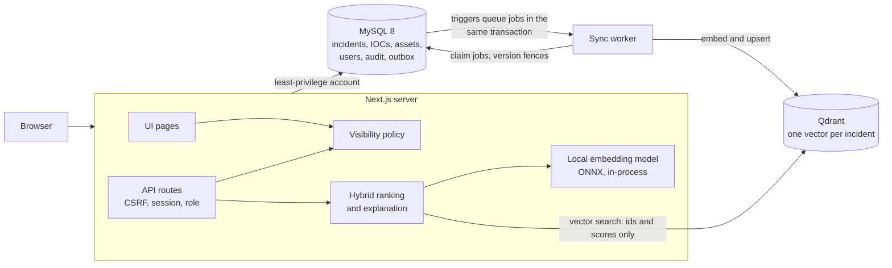

# SentinelDB

**A relational–vector hybrid database system for cybersecurity incident intelligence.**


SentinelDB helps a security operations team answer one question: *"Have we seen an incident like this before, and what did we do?"* It stores incidents, indicators of compromise (IOCs), affected assets and a tamper-evident audit history in **MySQL**, and uses **Qdrant** for semantic search over incident narratives. Search results are re-ranked with relational evidence, such as shared IOCs and shared assets, and every result comes with an explanation of its ranking.

Developed as a DBMS mini project (Semester 5). **All data is synthetic.** No real incident, indicator, person or organisation appears in this repository.

## Contents

- [Key features](#key-features)
- [Architecture](#architecture)
- [Technology stack](#technology-stack)
- [Getting started](#getting-started)
- [Security design](#security-design)
- [Testing and evaluation](#testing-and-evaluation)
- [Repository structure](#repository-structure)
- [Documentation](#documentation)
- [Known limitations](#known-limitations)
- [AI-assisted development](#ai-assisted-development)
- [Team](#team)
- [License](#license)

## Key features

- **Rules enforced inside the database.** Incident status follows a table-driven state machine enforced by triggers. Closing an incident requires all IOCs to be reviewed and asset impact to be described. Business rules live in stored procedures.
- **Immutable audit trail.** Status, assignment, evidence and account changes are recorded by triggers, only when something really changed, with the acting user and database account. History rows cannot be edited or deleted.
- **Least-privilege access.** The web application connects with per-table and per-column grants. It cannot read password hashes, set a status directly, or delete audit rows.
- **Hybrid search with explanations.** Semantic similarity (local MiniLM-L6-v2 embeddings, no external API) is combined with shared IOCs and assets. Each result states why it ranked where it did.
- **Reliable MySQL-to-Qdrant sync.** A transactional outbox and a worker keep the vector index consistent with the authoritative data, with retries, version fences and a full reconciliation check.
- **Web application and API.** Next.js UI and 22 API routes with sessions, roles, CSRF protection, login rate limiting and visibility rules that return 404 for out-of-scope incidents.
- **Analytics.** Views and report queries (window functions, aggregates, subqueries) with an EXPLAIN-driven index review on a 50,000-incident scaled copy.

## Architecture



MySQL is the single source of truth. Qdrant holds only derived data (an id and a vector per incident, no narrative text) and can be rebuilt from MySQL at any time. More detail: [`docs/ARCHITECTURE.md`](docs/ARCHITECTURE.md), [`docs/ER.md`](docs/ER.md).

## Technology stack

| Layer | Technology |
|---|---|
| Relational database | MySQL 8.0 (triggers, stored procedures, views, 15 versioned migrations) |
| Vector database | Qdrant 1.19 |
| Embeddings | all-MiniLM-L6-v2 via ONNX Runtime, run locally |
| Application | Next.js, React, TypeScript, Zod |
| Testing | Vitest against real MySQL and Qdrant servers |
| Tooling | Docker Compose (optional), GitHub Actions (type-check) |

## Getting started

### Prerequisites

- Node.js 22 or newer (`.nvmrc` is provided)
- MySQL 8.0 and Qdrant 1.19, either installed natively or started with Docker Compose
- A bash shell for the setup scripts. On Windows, run **all commands below from Git Bash, not PowerShell**. In PowerShell, `bash` can resolve to WSL, which runs the scripts in a different environment and breaks `npm run db:grants` (the test schema is not created)

### 1. Install

```bash
git clone <repository-url>
cd sentineldb
cp .env.example .env     # replace every "replace-me-..." value with your own password
npm ci
npm run model:setup      # downloads the embedding model and verifies its SHA-256 against models/MANIFEST.json
```

### 2. Start MySQL and Qdrant

**Option A: Docker Compose**

```bash
docker compose up -d
```

In `.env`, set `MYSQL_ROOT_CMD="docker compose exec -T mysql mysql -uroot -p<your MYSQL_ROOT_PASSWORD>"`.

If MySQL or Qdrant is already running on your machine, the ports will clash ("port is already allocated"). Choose free ports in `.env`: `MYSQL_PORT` (container is published on it), and `QDRANT_PORT` together with the same port in `QDRANT_URL`. Then run `docker compose up -d` again.

**Option B: native binaries**

- MySQL 8.0 must allow trigger creation for non-admin accounts: `SET PERSIST log_bin_trust_function_creators = 1;` (or run MySQL with `--skip-log-bin`).
- Start Qdrant: `./scripts/qdrant-native.sh /path/to/qdrant &`

### 3. Create the database and load the demo data

```bash
./scripts/bootstrap-db.sh       # creates the database and three accounts: migrator, app, app_test
npm run db:reset                # applies all migrations
npm run db:grants               # applies least-privilege grants
npm run db:seed -- demo         # about 240 synthetic incidents, replayed through the real lifecycle
npm run sync:worker -- --once   # builds the vector index (about 25 seconds)
```

### 4. Run

```bash
npm run dev            # http://localhost:3000
npm run dev:logins     # prints a one-time admin login and analyst login for the demo data
```

For production mode: `npm run build && npm start`. Production mode requires HTTPS; see [Known limitations](#known-limitations).

### Run the tests

```bash
npm run typecheck
npm test                  # needs MySQL and Qdrant running
npm run e2e:smoke         # after `npm run build`: API and UI checks against a real `next start`
```

More commands (reports, EXPLAIN review, evaluation, live demo) are in [`docs/STATUS.md`](docs/STATUS.md) and [`docs/DEMO.md`](docs/DEMO.md).

## Security design

- **Authentication:** scrypt password hashing, server-side sessions (only a token hash is stored; 8 hour lifetime, 30 minute idle timeout, revocable), login rate limiting from an append-only log.
- **Authorization:** roles plus an incident visibility policy applied after vector retrieval. Out-of-scope incident ids return 404 on every endpoint. Request bodies are strictly validated, which prevents mass assignment.
- **CSRF:** origin check on all state-changing requests.
- **Database account separation:** a migrator account for DDL, a runtime account with column-level grants, and a separate test account on a separate schema.
- **Integrity in the database:** state changes only through procedures and triggers, audit tables immutable even for privileged accounts, last-admin rule, deactivation revokes sessions.
- **Data minimisation in the vector store:** Qdrant holds ids, hashes and vectors only, never narrative text.
- **Secrets:** `.env` is git-ignored. Only `.env.example` is committed.

Design decisions and their trade-offs are recorded in [`docs/DECISIONS.md`](docs/DECISIONS.md).

## Testing and evaluation

- **230 automated tests** run against real MySQL and Qdrant servers, with no mocks for database behaviour. Many tests execute SQL as the restricted runtime account.
- **Mutation checks** on critical code paths confirm that the tests fail when the code is broken. Results, including mutants that survived, are in [`docs/evidence/`](docs/evidence/).
- **Independent cross-check** of the embedding pipeline against a second implementation in Python (cosine similarity 1.000000). Optional: `npm run verify:embedding`, with Python packages in [`scripts/verify/requirements.txt`](scripts/verify/requirements.txt).
- **Search evaluation:** keyword, vector, relational-only and hybrid ranking were compared on 24 frozen queries written separately from the data generator. On queries that carry IOCs or assets, hybrid ranked best on the lenient metrics but the differences are not statistically significant, and relational-only was ahead on some campaign metrics. The numbers, method and caveats are in [`eval/README.md`](eval/README.md).
- **Recorded outputs** of the verification runs (tests, build, audit, EXPLAIN, end-to-end) are in [`docs/evidence/`](docs/evidence/).

## Repository structure

```
db/            SQL: migrations (0001-0015), seed data, grants template, demo and report queries
src/app/       Next.js application: UI pages and API routes
src/lib/       Shared code: database access, authentication, ranking, embeddings, Qdrant client
scripts/       Command-line tools: migrations, seeding, sync worker, evaluation, setup, verification
tests/         Automated tests
eval/          Evaluation protocol, query files and harness notes
docs/          Architecture, decisions, API, data dictionary, ER diagram, demo guide, evidence
models/        Embedding model settings and hashes (large weights are downloaded, not stored in Git)
phase1/        Submitted Phase 1 deliverables, preserved unchanged
```

## Documentation

| Topic | Document |
|---|---|
| Plain-English project guide | [`docs/PROJECT_GUIDE.md`](docs/PROJECT_GUIDE.md) |
| Architecture | [`docs/ARCHITECTURE.md`](docs/ARCHITECTURE.md) |
| Design decisions (ADRs) | [`docs/DECISIONS.md`](docs/DECISIONS.md) |
| Tables, relationships | [`docs/ER.md`](docs/ER.md), [`docs/DATA_DICTIONARY.md`](docs/DATA_DICTIONARY.md) |
| Ranking method | [`docs/RANKING.md`](docs/RANKING.md) |
| Index review | [`docs/INDEXING.md`](docs/INDEXING.md) |
| HTTP API | [`docs/API.md`](docs/API.md) |
| Demo walkthrough | [`docs/DEMO.md`](docs/DEMO.md) |
| Detailed status of every capability | [`docs/STATUS.md`](docs/STATUS.md) |
| Dependency audit, model provenance | [`docs/DEPENDENCY_AUDIT.md`](docs/DEPENDENCY_AUDIT.md), [`docs/MODEL.md`](docs/MODEL.md) |
| How AI was used | [`docs/AI_USAGE.md`](docs/AI_USAGE.md) |
| Viva preparation | [`docs/VIVA.md`](docs/VIVA.md) |

## Known limitations

- The dataset is synthetic and generated from templates. Results show that the mechanisms work. They do not predict performance on real incident data.
- The evaluation is small (24 queries, one dataset). Differences of a few points are noise.
- The database records the actor that the trusted application asserts, next to the real database account. It cannot authenticate end users. A privileged DDL account can drop the audit triggers.
- Production mode uses `Secure` cookies and needs HTTPS. Browsers exempt only `localhost`. Do not expose this build to the internet as it is.
- Per-IP login limiting works only behind a reverse proxy (`TRUST_PROXY_HEADERS=true`). Without one, per-account and global limits still apply.
- The embedding model files came from a third-party npm repackaging. Hashes are pinned, but equality with the upstream release is not proven. See [`docs/MODEL.md`](docs/MODEL.md).
- Run on Windows 11 with MySQL 8.0.46 and Qdrant 1.19.2, natively and with Docker Compose.
- Running on Docker exposed a concurrency bug in the sync worker (InnoDB deadlocks between parallel workers were retried in the claim step but not in the job-state updates). It is fixed, and the affected test passed 40 of 40 repeated runs afterwards. Details: [`docs/evidence/docker-run.txt`](docs/evidence/docker-run.txt).
The full list, with the evidence behind each statement, is in [`docs/STATUS.md`](docs/STATUS.md).

## AI-assisted development

AI tooling (Claude Code) was used as an engineering assistant, mainly to draft and iterate on the more complex components: database triggers and procedures, the sync worker, ranking and tests. The team defined the requirements and design, made the decisions recorded in [`docs/DECISIONS.md`](docs/DECISIONS.md), wrote the evaluation queries, ran the system against real services, and reviewed and accepted every change. Generated code is accepted only when an executable test, an independent cross-check or a recorded command output supports it. The assistant's own claims are not evidence.

The details are in [`docs/AI_USAGE.md`](docs/AI_USAGE.md): who did what, where AI assisted, and the controls applied to its output. Team rules are in [`CONTRIBUTING.md`](CONTRIBUTING.md).

## Team

| Name | SRN | GitHub | Responsibilities |
|---|---|---|---|
| Dasari Vinay | PES2UG24CS145 | [@v1nayd](https://github.com/v1nayd) | Core database logic (lifecycle triggers, procedures, grants, audit); search (embeddings, Qdrant, sync worker, hybrid ranking, evaluation) |
| Dwijesh Krishna | PES2UG24CS169 | [@Dwijesh60](https://github.com/Dwijesh60) | Analytics and reporting (views, report queries), indexing and EXPLAIN review, DDL demo, data dictionary and ER, integrity checks, seed data |

Individual contributions are visible in the commit history and on the [contributors graph](../../graphs/contributors). Working agreements: [`CONTRIBUTING.md`](CONTRIBUTING.md).

## License

Released under the [MIT License](LICENSE). The embedding model all-MiniLM-L6-v2 is licensed separately (Apache-2.0).
