# SentinelDB entity-relationship diagram (as built)

> **Generated** by `npm run db:dictionary` from the live catalog: every base table, its primary (PK), foreign (FK) and
> unique (UK) key columns, and every foreign key. `||--o{` = one parent, many children; `|o--o{` = the foreign key is
> optional (nullable). All foreign keys are `ON DELETE RESTRICT` (migration 0003): users are deactivated and
> incidents archived, never deleted. The Phase 1 diagram is kept unchanged in `phase1/`. Column details:
> [DATA_DICTIONARY.md](DATA_DICTIONARY.md).

```mermaid
erDiagram
  Assets {
    int asset_id PK
    varchar asset_name
    varchar asset_type
    varchar ip_address
    tinyint criticality_level
    varchar owner_department
    datetime last_audited_at
  }
  Auth_Events {
    bigint auth_event_id PK
    varchar event_type
    varchar email_attempted
    int user_id FK
    varchar ip
    datetime created_at
  }
  Embedding_Jobs {
    bigint job_id PK
    int incident_id FK
    int narrative_version
    varchar action
    varchar status
    int attempts
    datetime available_at
    datetime locked_at
    varchar locked_by
    varchar last_error
    datetime created_at
    datetime finished_at
  }
  Incident_Asset {
    int incident_id PK, FK
    int asset_id PK, FK
    text impact_description
  }
  Incident_Assignment_History {
    int assignment_event_id PK
    int incident_id FK
    int old_assignee FK
    int new_assignee FK
    int changed_by FK
    varchar actor_name_snapshot
    varchar db_account
    varchar source
    varchar reason
    datetime changed_at
  }
  Incident_Evidence_History {
    int evidence_event_id PK
    int incident_id FK
    int ioc_id FK
    int asset_id FK
    varchar action
    varchar detail
    int changed_by FK
    varchar actor_name_snapshot
    varchar db_account
    varchar source
    datetime changed_at
  }
  Incident_IOC {
    int incident_id PK, FK
    int ioc_id PK, FK
    text notes
    varchar review_status
    int reviewed_by FK
    datetime reviewed_at
  }
  Incident_Playbook {
    int incident_id PK, FK
    int playbook_id PK, FK
    datetime applied_at
  }
  Incident_Status_History {
    int history_id PK
    int incident_id FK
    varchar old_status
    varchar new_status
    int changed_by FK
    varchar actor_name_snapshot
    varchar db_account
    varchar source
    varchar reason
    datetime changed_at
  }
  Incidents {
    int incident_id PK
    varchar title
    text narrative
    varchar severity
    varchar status
    int reported_by FK
    int assigned_to FK
    datetime created_at
    datetime resolved_at
    datetime updated_at
    int narrative_version
    datetime archived_at
    int archived_by FK
    varchar archive_reason
  }
  IOCs {
    int ioc_id PK
    varchar ioc_type
    varchar ioc_value
    datetime first_seen
    varchar threat_level
  }
  Notes {
    int note_id PK
    int incident_id FK
    int author_id FK
    text content
    datetime created_at
  }
  Playbooks {
    int playbook_id PK
    varchar name UK
    varchar applicable_incident_type
    text steps_description
    int created_by FK
  }
  schema_migrations {
    int version PK
    varchar name
    char checksum
    datetime applied_at
  }
  Sessions {
    char token_hash PK
    int user_id FK
    datetime created_at
    datetime last_seen_at
    datetime expires_at
    datetime revoked_at
    varchar ip
    varchar user_agent
  }
  Status_Transitions {
    varchar from_status PK
    varchar to_status PK
    varchar requires_role
    tinyint requires_reason
    varchar description
  }
  User_Account_History {
    int account_event_id PK
    int user_id FK
    varchar action
    varchar detail
    int changed_by FK
    varchar actor_name_snapshot
    varchar db_account
    varchar source
    datetime changed_at
  }
  Users {
    int user_id PK
    varchar name
    varchar email UK
    varchar password_hash
    varchar role
    tinyint is_active
    datetime deactivated_at
    int deactivated_by FK
    datetime password_changed_at
    datetime created_at
  }
  Users |o--o{ Auth_Events : "user_id"
  Incidents ||--o{ Embedding_Jobs : "incident_id"
  Assets ||--o{ Incident_Asset : "asset_id"
  Incidents ||--o{ Incident_Asset : "incident_id"
  Users ||--o{ Incident_Assignment_History : "changed_by"
  Incidents ||--o{ Incident_Assignment_History : "incident_id"
  Users |o--o{ Incident_Assignment_History : "new_assignee"
  Users |o--o{ Incident_Assignment_History : "old_assignee"
  Assets |o--o{ Incident_Evidence_History : "asset_id"
  Users ||--o{ Incident_Evidence_History : "changed_by"
  Incidents ||--o{ Incident_Evidence_History : "incident_id"
  IOCs |o--o{ Incident_Evidence_History : "ioc_id"
  Incidents ||--o{ Incident_IOC : "incident_id"
  IOCs ||--o{ Incident_IOC : "ioc_id"
  Users |o--o{ Incident_IOC : "reviewed_by"
  Incidents ||--o{ Incident_Playbook : "incident_id"
  Playbooks ||--o{ Incident_Playbook : "playbook_id"
  Users ||--o{ Incident_Status_History : "changed_by"
  Incidents ||--o{ Incident_Status_History : "incident_id"
  Users |o--o{ Incidents : "archived_by"
  Users |o--o{ Incidents : "assigned_to"
  Users ||--o{ Incidents : "reported_by"
  Users ||--o{ Notes : "author_id"
  Incidents ||--o{ Notes : "incident_id"
  Users |o--o{ Playbooks : "created_by"
  Users ||--o{ Sessions : "user_id"
  Users |o--o{ User_Account_History : "changed_by"
  Users ||--o{ User_Account_History : "user_id"
  Users |o--o{ Users : "deactivated_by"
```

