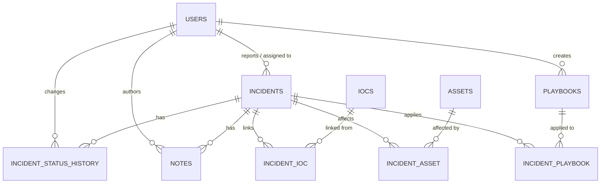

# DBMS Level 3 Project Specification
### Project selection, architecture, and Week 2 deliverables (ER → Relational Schema → DDL)

---

## 1. Understanding of the DBMS Requirements

Stripped to its core, a Level 3 project is being graded on three things simultaneously: **whether the database is the hard part of the system** (not the UI), **whether the schema and queries could survive scrutiny in a real engineering review**, and **whether two people can actually finish it**. The checklist (SQL + a second paradigm, four+ advanced concepts, RBAC, full CRUD-plus-analytics, documentation, originality) is really testing one underlying question: *does the problem you picked force these features to exist naturally, or are you bolting them on to satisfy a rubric?*

Two traps are called out explicitly and are worth restating because they're the most common ways teams lose marks even with a "good" idea:
- **A second database used for no real reason** (e.g., dumping the same rows into MongoDB just to say "NoSQL") reads as checklist-satisfying, not architecture.
- **A technically flashy idea with a hollow schema** (three tables and a lot of AI branding) scores worse than a plain-sounding problem with a genuinely rich relational model.

---

## 2. What Makes a Strong Level 3 Project

| Weak / generic project | Strong Level 3 project |
|---|---|
| A handful of tables, mostly 1:N, no real constraints beyond FK | Multiple M:N relationships, at least one weak/associative entity, meaningful CHECK/UNIQUE constraints |
| "NoSQL" or "vector" bolted on to unrelated data | Second paradigm holds data that is *structurally* unsuited to relational tables (free text needing semantic search, deeply nested/variable-shape documents) |
| Queries are "SELECT * WHERE id = ?" | Queries answer operational questions a real stakeholder would ask (workload per analyst, trend over time, outlier detection) |
| Transactions/triggers added just to tick a box | Transactions protect a genuine multi-step operation; triggers enforce a rule the application could otherwise violate |
| Roles differ only in a hidden button | Roles differ in *which rows* they can see/write — real authorization, not cosmetic |
| Demo is "add a record, show it in a table" | Demo is a causal chain: action → transaction → trigger → state change → analytical query → visible result |

An AI project that "happens to store data in a database" fails this bar because the data model is incidental — you could swap Postgres for a flat file and lose nothing. A Level 3 DBMS project should break, or at least visibly degrade, if you removed the relational integrity or the second paradigm.

---

## 3. Top 5 Project Ideas

1. **SentinelDB** — Cybersecurity Incident Intelligence & Threat Correlation Platform
2. **FraudLens** — Financial Transaction Fraud & Dispute Risk Intelligence Platform
3. **ForensicChain** — Digital Forensics Evidence & Chain-of-Custody Management System
4. **ReliefNet** — Disaster/Emergency Resource Allocation & Coordination Platform
5. **SupplyIQ** — Supply Chain Disruption & Supplier Risk Intelligence Platform

Brief case for each:

- **SentinelDB**: incidents, indicators of compromise, assets, and analysts form a naturally rich relational graph, and incident narratives are exactly the kind of free text where "find something similar to this" is a real, valuable, non-obvious feature — a genuine reason for a vector database.
- **FraudLens**: transactions and disputes are the textbook case for ACID transactions actually mattering, and SQL analytics (rolling aggregates, outlier queries) is extremely natural. Weaker vector justification — dispute text exists but is thinner than incident narratives.
- **ForensicChain**: chain-of-custody is inherently an audit-trail problem, which maps beautifully onto triggers and immutable logs. Less industry buzz for a resume, and demo is less visually dynamic.
- **ReliefNet**: socially meaningful, decent M:N richness (needs ↔ resources), but has a geospatial dimension that adds complexity without adding required DBMS concepts, and "government/NGO tooling" is a slightly harder sell on a resume than fintech/security.
- **SupplyIQ**: solid but the least differentiated — closest in spirit to a generic "operations dashboard," and its NoSQL/vector justification is the weakest of the five.

---

## 4. Comparison / Scoring Table

Scored out of 10 per criterion; Overall = simple average (not weighted toward tech impressiveness).

| Criterion | SentinelDB | FraudLens | ForensicChain | ReliefNet | SupplyIQ |
|---|---|---|---|---|---|
| Problem impact | 9 | 9 | 8 | 9 | 8 |
| Industry relevance | 10 | 10 | 7 | 6 | 8 |
| DBMS depth | 9 | 9 | 9 | 8 | 8 |
| SQL complexity | 9 | 10 | 8 | 8 | 8 |
| NoSQL/vector justification | 9 | 7 | 7 | 7 | 7 |
| Advanced DB features | 9 | 9 | 9 | 8 | 8 |
| Application/demo potential | 9 | 8 | 7 | 8 | 7 |
| Resume value | 10 | 9 | 7 | 7 | 8 |
| GitHub value | 9 | 8 | 8 | 8 | 7 |
| Originality | 8 | 7 | 9 | 8 | 7 |
| Semester feasibility | 7 | 8 | 8 | 7 | 8 |
| **Overall (avg)** | **8.9** | **8.5** | **7.9** | **7.6** | **7.6** |

**By category:**
- Strongest overall: **SentinelDB**
- Most technically impressive: **SentinelDB** (relational + vector correlation engine)
- Safest to complete: **ForensicChain** (narrow, well-bounded domain — audit logging is conceptually simple to scope correctly)
- Most resume-friendly: **SentinelDB**, with FraudLens a close second (security and fintech are the two hottest recruiter-facing domains right now)
- Most visually impressive demo: **ReliefNet** (map-based real-time allocation view), though SentinelDB's similarity-search "wow moment" is close behind

---

## 5. Final Recommendation

**SentinelDB.** It wins on the criteria that matter most for a Level 3 grade *and* a resume: the relational model is rich without being padded, the vector-search justification is one of the strongest of any candidate (semantic similarity over incident text is a real, demo-able capability that keyword search genuinely cannot do), and cybersecurity is currently one of the most recognizable domains to any evaluator or recruiter.

**Honest weaknesses, stated up front (per your own instruction not to just agree with the direction you were leaning):**
- You will not have real incident data. This must be handled by clearly labeling your dataset as **synthetic/simulated for academic purposes** in the README — do not imply it's real threat intelligence.
- "Vector search over support-ticket-like text" is a pattern that shows up in enough tutorials that you need *some* original angle beyond "search box that returns similar rows." Section 16 below gives you one (a side-by-side full-text vs. semantic-search demo panel) that turns this into a deliberate teaching moment rather than a copied pattern.
- The biggest real risk is scope creep into "build a mini SIEM." Section 24 addresses this directly — the fix is aggressive exclusion of live threat-feed ingestion, not a smaller schema.

If, after Week 2, the vector-search integration turns out to be more infrastructure than your team can manage alongside coursework, **FraudLens is the documented fallback** — same relational rigor, transactions matter even more concretely (money movement), and it only trades away some originality and vector-justification strength.

---

## 6. Final Project Title

- **Formal academic title:** SentinelDB: A Relational–Vector Hybrid Database System for Cybersecurity Incident Intelligence and Threat Correlation
- **Short product name:** SentinelDB
- **Tagline:** "Every incident you log makes the next one easier to recognize."

---

## 7. Problem Statement

Security teams at small and mid-size organizations typically log incidents (phishing attempts, unauthorized access, malware alerts) as individual tickets in general-purpose helpdesk or spreadsheet tools. Analysts handling a new incident routinely need to know: *have we seen something like this before, and what did we do about it?* Because incidents are stored as loosely structured tickets with no enforced relationship to the indicators of compromise (IPs, file hashes, domains) or assets involved, this correlation work is done manually — an analyst re-reading old ticket text and relying on memory or basic keyword search, which only matches exact wording rather than similar meaning.

SentinelDB manages three categories of information: structured incident metadata and relationships (who reported it, what asset was affected, what indicators were involved, current status), a full audit trail of how an incident's status changed over time, and unstructured narrative text (incident descriptions and analyst notes) that describes what actually happened in natural language. The system's job is to enforce integrity and role-based access over the structured side while making the unstructured side *searchable by meaning*, not just by keyword — surfacing related past incidents even when the wording differs. Database technology is central here because the value of the system comes entirely from correctly modeling the relationships between incidents, indicators, and assets, and from an index structure (vector similarity) purpose-built for a query relational tables cannot answer on their own.

---

## 8. Objectives

1. Design a normalized relational schema modeling incidents, assets, indicators of compromise (IOCs), analysts, and their relationships, with full referential integrity.
2. Implement role-based access control distinguishing SOC Analysts from Security Managers/Admins, enforced at the API and query level.
3. Enforce the incident lifecycle (Open → Investigating → Contained → Resolved → Closed) through database constraints, triggers, and transactions rather than application code alone.
4. Implement semantic similarity search over incident narratives using a vector database to surface related historical incidents.
5. Provide analytical views answering operational questions (mean time to resolve by severity, workload per analyst, most-affected assets) via SQL aggregation.
6. Demonstrate at least four advanced database concepts: transactions, triggers, stored procedures/functions, and vector similarity search.
7. Deliver a role-scoped Next.js application with an authenticated API layer connecting to both databases.
8. Document the architecture and the SQL/vector boundary decisions clearly enough to defend them in a faculty evaluation.

---

## 9. Scope

**In scope**
- Incident CRUD and full lifecycle management
- IOC management and incident↔IOC linking
- Asset inventory and incident↔asset linking
- Analyst assignment and reassignment
- Semantic correlation search over incident narratives (vector DB)
- Manager-facing analytics dashboards (SQL views/aggregates)
- Two roles: SOC Analyst, Security Manager/Admin
- Trigger-based audit log of status changes

**Out of scope**
- Live external threat-feed ingestion (e.g., real MISP/VirusTotal API integration)
- Automated malware detonation/sandboxing
- Real-time network packet capture or SIEM-scale log ingestion
- Production-grade penetration testing or compliance certification

**Future enhancements**
- Real threat-intel feed ingestion
- ML-based severity prediction
- Automated playbook execution (SOAR-style)
- Multi-tenant organization support

---

## 10. Core Users and Roles

**SOC Analyst**
- *Permissions:* create incidents, view/update incidents assigned to them, add IOCs and notes, run correlation search
- *Data access:* own assigned incidents and any incident they reported; cannot view other analysts' performance metrics
- *DB operations:* INSERT/UPDATE scoped to `Incidents` rows where they are `reported_by` or `assigned_to`; INSERT into `Notes`, `Incident_IOC`, `Incident_Asset`

**Security Manager / Admin**
- *Permissions:* full visibility across all incidents and analysts, reassign/close/reopen incidents, manage asset inventory and user accounts, view org-wide analytics
- *Data access:* all rows in all tables
- *DB operations:* full CRUD, plus execution of the `close_incident()` stored procedure and access to workload/analytics views

---

## 11. Core Features

**1. Essential MVP**
- Auth (login, role assignment)
- Incident CRUD with status field
- Asset and IOC tables with linking to incidents
- Basic incident list/detail views
- One aggregate dashboard query

**2. Strong Level 3 features**
- Vector similarity search ("Find Similar Incidents")
- Trigger-based status-change audit log
- Stored procedure enforcing closure rules
- `analyst_workload_view` and `incident_summary_view`
- Transactional multi-step reassignment workflow

**3. Optional advanced features**
- Full-text search shown side-by-side with vector search
- Graph visualization of incident–IOC–asset network
- Exportable incident report (PDF)

---

## 12. ER Diagram Specification

**A ready-to-edit draw.io file (`sentineldb-er-diagram.drawio`) is provided alongside this document** — open it at [app.diagrams.net](https://app.diagrams.net) via File → Open From → Device. It contains all 10 entities laid out below, color-coded (blue = strong entity, red = central entity, green = associative/M:N junction, dashed yellow = weak entity), with every relationship line labeled by cardinality, plus a legend. The Mermaid block below is the same structure in text form, useful for a quick reference or for pasting into a GitHub README (GitHub renders Mermaid natively).



### Entities

**Users** — represents analysts and admins. PK `user_id`. Candidate key `email` (UNIQUE). Attributes: name, email, password_hash, role (CHECK: analyst/admin), created_at.

**Assets** — organizational IT assets that can be affected by incidents. PK `asset_id`. Attributes: asset_name, asset_type (CHECK), ip_address, criticality_level (CHECK 1–5), owner_department.

**Incidents** — the central entity. PK `incident_id`. FKs: `reported_by`→Users (NOT NULL), `assigned_to`→Users (nullable). Attributes: title, narrative (source-of-truth text), severity (CHECK), status (CHECK, default 'open'), created_at, resolved_at (nullable). Derived attribute: resolution time = resolved_at − created_at, computed in a view, not stored.

**IOCs** — indicators of compromise. PK `ioc_id`. Attributes: ioc_type (CHECK), ioc_value, first_seen, threat_level. Candidate key: UNIQUE(ioc_type, ioc_value).

**Incident_Status_History** — weak entity; existence depends entirely on its parent Incident. PK `history_id`. FKs: `incident_id`→Incidents, `changed_by`→Users. Attributes: old_status, new_status, changed_at. Populated exclusively by trigger, never by direct application INSERT.

**Notes** — analyst free-text notes over time. PK `note_id`. FKs: `incident_id`→Incidents, `author_id`→Users. Attributes: content, created_at.

**Playbooks** — reusable response procedures. PK `playbook_id`. FK: `created_by`→Users. Attributes: name (UNIQUE), applicable_incident_type, steps_description.

### Associative entities (M:N)

- **Incident_IOC** (Incidents M:N IOCs) — composite PK (incident_id, ioc_id), attribute `notes`.
- **Incident_Asset** (Incidents M:N Assets) — composite PK (incident_id, asset_id), attribute `impact_description`.
- **Incident_Playbook** (Incidents M:N Playbooks) — composite PK (incident_id, playbook_id), attribute `applied_at`.

### Relationship cardinalities

| Relationship | Cardinality | Participation |
|---|---|---|
| Users reports Incidents | 1:N | Total on Incidents (every incident has a reporter) |
| Users assigned_to Incidents | 1:N | Partial (assignment may be null) |
| Incidents linked to IOCs | M:N | Partial both sides |
| Incidents affects Assets | M:N | Partial both sides |
| Incidents has Status_History | 1:N | Total on history (weak entity) |
| Incidents has Notes | 1:N | Partial |
| Users authors Notes | 1:N | Total on Notes |
| Incidents applies Playbooks | M:N | Partial both sides |

No natural 1:1 relationship exists in this domain, and none is introduced artificially — forcing one would not serve the problem.

---

## 13. Relational Schema

```
Users(
  user_id        PK,
  name           NOT NULL,
  email          UNIQUE NOT NULL,
  password_hash  NOT NULL,
  role           NOT NULL CHECK (role IN ('analyst','admin')),
  created_at     DEFAULT CURRENT_TIMESTAMP
)

Assets(
  asset_id           PK,
  asset_name         NOT NULL,
  asset_type         NOT NULL CHECK (asset_type IN ('server','workstation','network_device','application')),
  ip_address,
  criticality_level  NOT NULL CHECK (criticality_level BETWEEN 1 AND 5),
  owner_department
)

Incidents(
  incident_id   PK,
  title         NOT NULL,
  narrative     NOT NULL,
  severity      NOT NULL CHECK (severity IN ('low','medium','high','critical')),
  status        NOT NULL DEFAULT 'open' CHECK (status IN ('open','investigating','contained','resolved','closed')),
  reported_by   NOT NULL, FK → Users.user_id  ON DELETE RESTRICT,
  assigned_to,             FK → Users.user_id  ON DELETE SET NULL,
  created_at    DEFAULT CURRENT_TIMESTAMP,
  resolved_at
)

IOCs(
  ioc_id       PK,
  ioc_type     NOT NULL CHECK (ioc_type IN ('ip','domain','file_hash','email','url')),
  ioc_value    NOT NULL,
  first_seen   DEFAULT CURRENT_TIMESTAMP,
  threat_level CHECK (threat_level IN ('low','medium','high','critical')),
  UNIQUE (ioc_type, ioc_value)
)

Incident_IOC(
  incident_id  FK → Incidents.incident_id ON DELETE CASCADE,
  ioc_id       FK → IOCs.ioc_id            ON DELETE CASCADE,
  notes,
  PRIMARY KEY (incident_id, ioc_id)
)

Incident_Asset(
  incident_id         FK → Incidents.incident_id ON DELETE CASCADE,
  asset_id            FK → Assets.asset_id        ON DELETE CASCADE,
  impact_description,
  PRIMARY KEY (incident_id, asset_id)
)

Incident_Status_History(
  history_id   PK,
  incident_id  NOT NULL, FK → Incidents.incident_id ON DELETE CASCADE,
  old_status,
  new_status   NOT NULL,
  changed_by   FK → Users.user_id ON DELETE SET NULL,
  changed_at   DEFAULT CURRENT_TIMESTAMP
)

Notes(
  note_id      PK,
  incident_id  NOT NULL, FK → Incidents.incident_id ON DELETE CASCADE,
  author_id    NOT NULL, FK → Users.user_id          ON DELETE RESTRICT,
  content      NOT NULL,
  created_at   DEFAULT CURRENT_TIMESTAMP
)

Playbooks(
  playbook_id           PK,
  name                  UNIQUE NOT NULL,
  applicable_incident_type,
  steps_description,
  created_by            FK → Users.user_id ON DELETE SET NULL
)

Incident_Playbook(
  incident_id  FK → Incidents.incident_id ON DELETE CASCADE,
  playbook_id  FK → Playbooks.playbook_id ON DELETE CASCADE,
  applied_at   DEFAULT CURRENT_TIMESTAMP,
  PRIMARY KEY (incident_id, playbook_id)
)
```

**Mapping notes:** every M:N relationship became its own associative table with a composite PK (standard M:N → table mapping). The weak entity `Incident_Status_History` carries a FK to its owner and is never directly writable by the application — only by trigger — which is itself part of the integrity design. `assigned_to` uses `ON DELETE SET NULL` (losing an analyst shouldn't destroy incident history) while `reported_by` and `author_id` use `RESTRICT` (you should never be able to delete a user out from under an audit-relevant record).

---

## 14. Normalization Analysis

**1NF:** Satisfied. No repeating groups or multi-valued attributes — the temptation to store IOCs as a comma-separated list on `Incidents` was deliberately avoided in favor of the `Incident_IOC` junction table.

**2NF:** Satisfied. Every composite-key table (`Incident_IOC`, `Incident_Asset`, `Incident_Playbook`) has its non-key attributes (`notes`, `impact_description`, `applied_at`) dependent on the *whole* composite key, not part of it — there's no partial-dependency violation.

**3NF:** Satisfied. No non-key attribute is transitively dependent on another non-key attribute. `Assets.owner_department` is a direct property of the asset, not derivable from another non-key column; `Incidents.assigned_to` is a foreign key, not a transitive attribute.

**Higher normalization (BCNF/4NF):** Not needed — every determinant in this schema is already a candidate key, so there are no BCNF violations to resolve, and forcing further decomposition would only add joins without removing any real redundancy.

**Anomalies avoided by this design:**
- *Update anomaly:* without `Incident_Status_History`, changing status would silently discard the previous state — the trigger-populated history table removes this.
- *Insertion anomaly:* without the IOC/Asset junction tables, adding a second IOC to an incident would require either a schema change or a fragile delimited string — the M:N tables avoid this entirely.
- *Deletion anomaly:* deleting an incident should not delete the user who reported it (handled via `RESTRICT`), and deleting a user shouldn't silently delete incident history (handled via `SET NULL` on `assigned_to`).

---

## 15. DDL Plan

**Database system: PostgreSQL**, over MySQL, for three concrete reasons relevant to this project specifically: native `CHECK` constraint support without workarounds, strong `tsvector`/GIN full-text search (useful for the side-by-side keyword-vs-semantic demo in Section 16), and the most common pairing with modern Next.js stacks and vector-database client libraries.

A note on the "second paradigm" choice: this project uses a **standalone vector database (Qdrant)** rather than the `pgvector` Postgres extension. `pgvector` would technically satisfy the letter of the requirement, but it keeps everything inside one engine — it doesn't demonstrate integrating two genuinely different database systems, which is part of what the rubric and your resume are rewarding. Qdrant runs easily in a single Docker container and has a simple JS/Python client, so the added operational cost is small relative to the architectural credit it earns.

```sql
-- ===== DATABASE =====
CREATE DATABASE sentineldb;

-- ===== CORE TABLES =====
CREATE TABLE Users (
    user_id       SERIAL PRIMARY KEY,
    name          VARCHAR(100) NOT NULL,
    email         VARCHAR(150) UNIQUE NOT NULL,
    password_hash VARCHAR(255) NOT NULL,
    role          VARCHAR(20) NOT NULL CHECK (role IN ('analyst','admin')),
    created_at    TIMESTAMP DEFAULT CURRENT_TIMESTAMP
);

CREATE TABLE Assets (
    asset_id          SERIAL PRIMARY KEY,
    asset_name        VARCHAR(150) NOT NULL,
    asset_type        VARCHAR(30) NOT NULL
        CHECK (asset_type IN ('server','workstation','network_device','application')),
    ip_address        VARCHAR(45),
    criticality_level SMALLINT NOT NULL CHECK (criticality_level BETWEEN 1 AND 5),
    owner_department  VARCHAR(100)
);

CREATE TABLE Incidents (
    incident_id   SERIAL PRIMARY KEY,
    title         VARCHAR(200) NOT NULL,
    narrative     TEXT NOT NULL,
    severity      VARCHAR(10) NOT NULL CHECK (severity IN ('low','medium','high','critical')),
    status        VARCHAR(20) NOT NULL DEFAULT 'open'
        CHECK (status IN ('open','investigating','contained','resolved','closed')),
    reported_by   INT NOT NULL REFERENCES Users(user_id) ON DELETE RESTRICT,
    assigned_to   INT REFERENCES Users(user_id) ON DELETE SET NULL,
    created_at    TIMESTAMP DEFAULT CURRENT_TIMESTAMP,
    resolved_at   TIMESTAMP
);

CREATE TABLE IOCs (
    ioc_id       SERIAL PRIMARY KEY,
    ioc_type     VARCHAR(20) NOT NULL CHECK (ioc_type IN ('ip','domain','file_hash','email','url')),
    ioc_value    VARCHAR(255) NOT NULL,
    first_seen   TIMESTAMP DEFAULT CURRENT_TIMESTAMP,
    threat_level VARCHAR(10) CHECK (threat_level IN ('low','medium','high','critical')),
    UNIQUE (ioc_type, ioc_value)
);

-- ===== JUNCTION / ASSOCIATIVE TABLES =====
CREATE TABLE Incident_IOC (
    incident_id INT REFERENCES Incidents(incident_id) ON DELETE CASCADE,
    ioc_id      INT REFERENCES IOCs(ioc_id) ON DELETE CASCADE,
    notes       TEXT,
    PRIMARY KEY (incident_id, ioc_id)
);

CREATE TABLE Incident_Asset (
    incident_id         INT REFERENCES Incidents(incident_id) ON DELETE CASCADE,
    asset_id            INT REFERENCES Assets(asset_id) ON DELETE CASCADE,
    impact_description  TEXT,
    PRIMARY KEY (incident_id, asset_id)
);

CREATE TABLE Playbooks (
    playbook_id               SERIAL PRIMARY KEY,
    name                      VARCHAR(150) UNIQUE NOT NULL,
    applicable_incident_type  VARCHAR(50),
    steps_description         TEXT,
    created_by                INT REFERENCES Users(user_id) ON DELETE SET NULL
);

CREATE TABLE Incident_Playbook (
    incident_id INT REFERENCES Incidents(incident_id) ON DELETE CASCADE,
    playbook_id INT REFERENCES Playbooks(playbook_id) ON DELETE CASCADE,
    applied_at  TIMESTAMP DEFAULT CURRENT_TIMESTAMP,
    PRIMARY KEY (incident_id, playbook_id)
);

-- ===== WEAK ENTITY / AUDIT LOG =====
CREATE TABLE Incident_Status_History (
    history_id  SERIAL PRIMARY KEY,
    incident_id INT NOT NULL REFERENCES Incidents(incident_id) ON DELETE CASCADE,
    old_status  VARCHAR(20),
    new_status  VARCHAR(20) NOT NULL,
    changed_by  INT REFERENCES Users(user_id) ON DELETE SET NULL,
    changed_at  TIMESTAMP DEFAULT CURRENT_TIMESTAMP
);

CREATE TABLE Notes (
    note_id     SERIAL PRIMARY KEY,
    incident_id INT NOT NULL REFERENCES Incidents(incident_id) ON DELETE CASCADE,
    author_id   INT NOT NULL REFERENCES Users(user_id) ON DELETE RESTRICT,
    content     TEXT NOT NULL,
    created_at  TIMESTAMP DEFAULT CURRENT_TIMESTAMP
);

-- ===== INDEXES (justified by real query patterns) =====
-- Dashboard filters incidents by status+severity constantly
CREATE INDEX idx_incidents_status_severity ON Incidents(status, severity);
-- IOC ingestion needs a fast existence check before insert
CREATE INDEX idx_iocs_value ON IOCs(ioc_value);
-- Workload queries group by assigned analyst
CREATE INDEX idx_incidents_assigned_to ON Incidents(assigned_to);

-- ===== VIEW (used in Section 17's demo) =====
CREATE VIEW analyst_workload_view AS
SELECT u.user_id, u.name,
       COUNT(*) FILTER (WHERE i.status NOT IN ('resolved','closed')) AS open_incidents,
       ROUND(AVG(EXTRACT(EPOCH FROM (i.resolved_at - i.created_at))/3600)::numeric, 2) AS avg_resolution_hours
FROM Users u
LEFT JOIN Incidents i ON i.assigned_to = u.user_id
WHERE u.role = 'analyst'
GROUP BY u.user_id, u.name;

-- ===== EXAMPLE ALTER / DROP (for the DDL execution deliverable) =====
ALTER TABLE Assets ADD COLUMN last_audited_at TIMESTAMP;
-- DROP TABLE Incident_Playbook;  -- example only, not executed in the seeded build
```

---

## 16. Advanced Database Roadmap

Four required, plus two bonus — all directly serve the problem rather than padding the checklist.

**1. Transactions** — *What:* wrap "reassign incident + record history + notify" as a single atomic unit. *Why needed:* without atomicity, a crash mid-operation could leave an incident reassigned with no corresponding history row — a real integrity gap in a security audit trail. *Tables:* Incidents, Incident_Status_History. *Demo:* show the operation succeeding, then force a failure partway through and show the rollback leaving both tables consistent.

**2. Triggers** — *What:* `AFTER UPDATE OF status ON Incidents` trigger that inserts a row into `Incident_Status_History` automatically. *Why needed:* guarantees the audit trail can never be bypassed by a bug in application code — the guarantee lives in the database, not the app. *Tables:* Incidents → Incident_Status_History. *Demo:* update status directly via `psql`, outside the app, and show the history row still appears.

**3. Stored procedures/functions** — *What:* `close_incident(incident_id)` checks that every linked IOC is marked reviewed and every linked asset has an impact description before allowing the status to move to `closed`, raising an exception otherwise. *Why needed:* enforces a real business rule ("don't close what you haven't documented") at the data layer. *Tables:* Incidents, Incident_IOC, Incident_Asset. *Demo:* attempt closure with an unreviewed IOC and show the rejection, then fix it and show success.

**4. Vector similarity search** — *What:* embed each incident's narrative and store the vector in Qdrant keyed by `incident_id`; "Find Similar Incidents" does a cosine-similarity nearest-neighbor query. *Why needed:* this is the feature SQL fundamentally cannot provide — matching by meaning, not keyword. *Demo:* the centerpiece — enter a new incident describing a phishing attempt in different words than an old one and show it surfaced anyway.

**5. Views (bonus)** — `analyst_workload_view` and `incident_summary_view` pre-join the tables analysts and managers query most, avoiding repeated complex joins scattered across API routes.

**6. Full-text search (bonus)** — Postgres `tsvector`/GIN index on `Incidents.title, narrative`, shown side-by-side with the vector search result for the *same* query, to make the "why do we need a second database" justification visible rather than asserted.

---

## 17. SQL + NoSQL/Vector Architecture

**SQL (PostgreSQL) holds:** Users, Assets, Incidents (including the narrative text itself, as the audit-relevant source of truth), IOCs, all three junction tables, Incident_Status_History, Notes, Playbooks.

**Why it must be SQL:** this data has fixed structure, strict referential dependencies (an `Incident_IOC` row is meaningless without both its incident and its IOC existing), and needs exact, non-fuzzy joins and aggregates for reporting. Losing a foreign-key link here isn't a UX problem — it's a security audit-trail integrity failure. ACID guarantees matter directly for the status-history and closure-rule logic.

**Vector DB (Qdrant) holds:** embeddings generated from `Incidents.narrative` (and optionally `Notes.content`), each point keyed by `incident_id` so it can be joined back to Postgres.

**Why this data can't just live in SQL:** the feature this data serves — "surface incidents that describe a similar situation, even in different words" — requires nearest-neighbor search over high-dimensional vectors. B-tree and GIN indexes (including Postgres full-text search) match on lexical/keyword overlap, not conceptual similarity; two incidents describing the same attack pattern in different phrasing would simply not match on keywords. This is a case where the justification is concrete and testable, not asserted — the Section 16 side-by-side demo proves it live rather than claiming it in a slide.

---

## 18. Next.js Application Architecture

```
Next.js (App Router, role-aware UI)
   │
   ├─ Login / Session (NextAuth.js or custom JWT, bcrypt password hashing)
   │
   ├─ API Route Handlers (REST)
   │     ├─ /api/incidents        → Postgres (Prisma/Drizzle)
   │     ├─ /api/incidents/[id]/similar → embed query text → Qdrant lookup → Postgres hydrate
   │     ├─ /api/admin/*          → role middleware restricts to 'admin'
   │     └─ /api/incidents/[id]/close → calls close_incident() stored procedure
   │
   ├─ Middleware: RBAC check on every API route (JWT role claim)
   │
   └─ Data layer
         ├─ PostgreSQL — via Prisma/Drizzle, parameterized queries only (no string-built SQL)
         └─ Qdrant — thin client wrapper; embeddings generated in-process (e.g., a local
            sentence-embedding model via transformers.js, avoiding a paid external API)
```

- **Authentication:** credential login, hashed passwords, JWT/session carrying a `role` claim.
- **Authorization:** middleware on every API route checks role and, for analysts, filters rows to `reported_by = self OR assigned_to = self`.
- **Validation:** Zod schemas on API input mirroring the DB's CHECK constraints (e.g., severity must be one of the four values) — the DB constraint is the last line of defense, not the first.
- **Error handling:** transaction failures roll back and return a structured error; if Qdrant is unreachable, the similarity endpoint falls back to the full-text search result with a note in the response, rather than failing the whole page.
- **Environment variables:** `DATABASE_URL`, `QDRANT_URL`, `JWT_SECRET`/`NEXTAUTH_SECRET` — committed only as `.env.example`, never as `.env`.
- **Security boundaries:** ORM/parameterized queries prevent SQL injection; the application's Postgres role is a least-privilege user, not the superuser; login is rate-limited.

---

## 19. Week 2 Deliverable Status — Verified

An honest status check against the three Week 2 requirements, rather than assuming they're satisfied because the text exists:

| Deliverable | Status | Evidence |
|---|---|---|
| 1. Convert ER diagram into relational schema | **Done** | Section 13 maps every entity, every M:N relationship to a junction table with composite PK, and the weak entity to its parent FK. |
| 2. Prepare DDL statements based on the schema | **Done** | Section 15 contains complete, runnable `CREATE TABLE`/`INDEX`/`VIEW` statements for all 10 tables. |
| 3. Execute the DDL statements | **Structurally validated, not yet executed on real Postgres** | See below — this needs to happen in your own environment, not assumed complete. |

**What "structurally validated" actually means:** this sandbox has no network access, so a real PostgreSQL instance couldn't be installed here to run the exact DDL. To still catch real bugs before you run it yourself, the schema was adapted (SERIAL → autoincrement, VARCHAR → TEXT — cosmetic, SQLite has no length-limited types) and executed against an in-memory SQLite database. Result: **all 13 CREATE statements ran successfully in dependency order**, and constraint checks confirmed the logic actually works — an invalid severity value was correctly rejected by the CHECK constraint, and a nonexistent foreign key was correctly rejected by the FK constraint. This proves the schema has no structural bugs (no ordering errors, no typos, no broken references) — it does **not** count as executing the Postgres DDL, since Postgres-specific behavior (SERIAL sequences, exact CHECK syntax, the view's `FILTER`/`EXTRACT` clauses) wasn't tested.

**What you still need to do, with real evidence to keep:**
1. Run the exact DDL from Section 15 against a real PostgreSQL instance — either installed locally, or a free hosted instance (Supabase, Neon, or ElephantSQL all offer this with no local install).
2. Confirm all 10 tables exist: `\dt` in `psql`, or `SELECT table_name FROM information_schema.tables WHERE table_schema='public';`
3. Run the sample INSERTs from the Week 2 plan below and take a screenshot of the successful output — this, not the SQLite run, is your actual submission evidence.

---

## 20. Week 2 Execution Plan

1. Lock the project title (**SentinelDB**) and confirm it's unique within your section.
2. Draw the ER diagram from Section 12 in a diagramming tool (dbdiagram.io or draw.io) for submission — the Mermaid block above is a ready-made starting structure.
3. Walk the relational schema in Section 13 against the diagram to confirm every relationship mapped correctly (M:N → junction table, weak entity → FK to parent).
4. Run the DDL in Section 15 against a local Postgres instance; verify all `CREATE TABLE` statements succeed in dependency order (parent tables before tables with FKs to them).
5. Insert 3–5 sample rows per table (a few users, assets, incidents, IOCs, and their junction-table links) to confirm constraints behave as intended — try an invalid `severity` value and confirm the CHECK constraint rejects it.
6. Write a short (roughly one-page) rationale note explaining the SQL/vector boundary (Section 17) for early instructor feedback, since this is the piece most likely to draw questions before you've built the rest.

---

## 21. Semester Roadmap

| Weeks | Focus |
|---|---|
| 3–4 | Backend scaffolding, auth, basic CRUD API routes **+ an early Qdrant/embedding feasibility spike (one embedding generated, one similarity query working end-to-end) to de-risk the highest-uncertainty piece before committing further design around it** |
| 5–6 | Junction-table logic, RBAC middleware, trigger + status-history implementation |
| 7–8 | Full Qdrant integration, embedding pipeline, "Find Similar Incidents" feature (building on the week 3–4 spike, not starting from zero) |
| 9–10 | Dashboards/views, index tuning, `close_incident()` stored procedure |
| 11–12 | Security hardening (rate limiting, least-privilege DB role), testing |
| 13–14 | Documentation, README, screenshots, demo rehearsal |
| 15 | Final submission and evaluation |

---

## 22. Resume Description

- Designed and implemented SentinelDB, a hybrid PostgreSQL + Qdrant vector-database system for cybersecurity incident tracking, modeling 10 normalized entities with full referential integrity, composite-key junction tables, and trigger-enforced audit logging.
- Built a role-based Next.js application (Analyst/Admin) with a REST API layer and JWT-based authorization, integrating semantic similarity search over incident narratives to surface related historical incidents beyond keyword matching.
- Implemented database-enforced business rules via stored procedures and multi-step transactions, and tuned dashboard query performance with targeted indexing validated through EXPLAIN ANALYZE.

## 23. GitHub Positioning

**Repository structure**
```
/app or /apps/web        Next.js frontend + API routes
/db/ddl.sql              Full schema from Section 15
/db/migrations/          Incremental migration history
/db/seed/                Synthetic sample dataset + seed script
/scripts/embed.ts        Embedding generation for Qdrant
/docs/er-diagram.png
/docs/architecture.md
README.md
.env.example
```

**README sections:** Project overview → Problem statement → Features → Architecture diagram → ER diagram → Database schema → SQL/vector justification (Section 17, verbatim reasoning) → Setup instructions → Environment variables → API documentation → Screenshots → Testing → Team contributions → Future enhancements.

---

## 24. Risks and Scope Control

Answering the Section-24-style questions directly and without softening:

- **Real risk:** the embedding pipeline becomes an open-ended infrastructure project. *Mitigation:* pick one embedding approach (in-process transformers.js model) in Week 7 and do not revisit the decision.
- **Real risk:** "just one more threat-feed integration" creeps into scope. *Mitigation:* this is explicitly out of scope (Section 9) — all incident data is synthetic and seeded, never live-fetched.
- **Real risk:** one teammate does all the frontend, the other all the backend, and the "both members do meaningful database work" requirement becomes hard to demonstrate. *Mitigation:* split by database responsibility instead — one owns schema/triggers/stored procedures, the other owns the Qdrant integration and analytics views — both are DB-facing, and both leave a clear, separable commit history.
- **If behind schedule, cut in this order:** (1) full-text-vs-vector side-by-side comparison, (2) `Incident_Playbook` richness, (3) PDF export — never cut the trigger/transaction/procedure trio or the vector search, since those are what the grade and the resume value both depend on.

---

## 25. Final Verdict

SentinelDB is the strongest fit against every stated goal: real relational depth, a vector-search justification you can defend with a live demo rather than a claim, and a domain that reads well on both a transcript and a resume. Its risk is entirely about discipline, not difficulty — the schema and architecture above are already scoped for two students in a semester; the failure mode to actively guard against is scope creep toward "real SOC tooling" rather than any missing capability. Proceed with Week 2 as laid out in Section 20.

---

## 26. Data Strategy — Defending the "No Real Data" Objection

**Reframe first:** not having real production incident data is not a weakness to apologize for. Real incident data is confidential by nature — no organization would (or should) hand two undergraduates its actual breach logs, and scraping/leaked data would be an ethics problem, not a workaround. The correct position for a defense is *"we deliberately did not use real proprietary data, for good reason,"* not *"we couldn't get real data."*

**1. Ground the schema and workflow in published industry standards, not invention.**
- The incident lifecycle (Open → Investigating → Contained → Resolved → Closed) operationalizes NIST SP 800-61's incident-handling phases.
- IOC typing (ip/domain/file_hash/email/url) aligns with MITRE ATT&CK indicator categories.
- State this explicitly during the demo: *"the schema isn't invented — it implements NIST SP 800-61 and MITRE ATT&CK."* This converts "you made this up" into "we implemented an existing framework."

**2. Build the synthetic dataset from real, public sources — not randomly generated text.**
- Base incident narratives on reworded (never copy-pasted) published breach case studies — CISA advisories, Verizon DBIR write-ups, vendor post-mortems.
- Source IOC values from legitimately public threat-intel feeds (abuse.ch, AlienVault OTX) rather than inventing them — public indicators, not proprietary org data.
- Match the incident-type distribution to DBIR's published real-world breakdown (phishing vs. malware vs. misconfiguration) instead of a uniform random split. This directly strengthens the vector-search demo: a realistic distribution creates genuine clusters of related incidents for "Find Similar Incidents" to surface, rather than noise.

**3. Prepare a rehearsed, direct answer for the evaluator's question.**
> "This is a synthetic dataset built on public breach case studies and threat-intel feeds — real incident logs are confidential, so using them wouldn't be appropriate for a student project. What we're demonstrating is the correlation mechanism itself, which works identically whether it's indexing 50 synthetic incidents or 50,000 real ones."

This separates *"does the architecture work"* (provable live, independent of data source) from *"do we have production data"* (correctly, no) — the distinction that actually resolves the objection rather than dodging it.

**4. Add a "Data & Ethics" subsection to the README** stating this strategy proactively, so it's answered before it's asked rather than surfacing defensively mid-demo.

---

## 27. Full Weakness Register & Evidence Plan

Every weakness identified so far, with a concrete mitigation and — critically — the actual evidence to bring to the defense, not just a reassurance that it's "handled."

| Weakness | Real rejection risk | Concrete mitigation | Evidence to bring to defense |
|---|---|---|---|
| Synthetic dataset — no proof of generalization | "How do we know this finds true positives, not just the ones you picked?" | Build 150–300 synthetic incidents, not 15–20. Have one teammate write fresh, unseen query incidents the corpus-builder never saw, and test similarity search against those. | A precision count from manually labeling ~15–20 queries (e.g., "24/30 top-3 results judged relevant"), stated with its limitations, not asserted as proof of production performance. |
| Vector search reads as a copied tutorial pattern | "Where's the database engineering, this is just a search box?" | Rank results using a combined SQL+vector score (severity, recency, asset overlap, weighted with similarity); reuse the same embedding mechanism for IOC de-duplication, not just narrative search. | Live demo of the combined-ranking query and the de-duplication feature — both require querying and merging both databases, not one after the other. |
| Scope creep toward a "mini SIEM" | Blown timeline late in the semester | Hard rule: no feature requiring a live external API key or new infrastructure beyond Postgres + Qdrant + Next.js. Written down in CONTRIBUTING notes, not left as a judgment call. | The out-of-scope list in Section 9, cited directly if asked why a "nice to have" feature is absent. |
| Feasibility score was the lowest of any criterion (7/10) | Embedding/Qdrant integration fails late with no buffer | Run a minimal embed-and-query spike in weeks 3–4, in parallel with backend scaffolding, instead of waiting until weeks 7–8 to first touch it. | Git history showing the spike commit exists well before the full-feature implementation — demonstrates deliberate risk management, not luck. |
| Uneven team contribution under direct questioning | An evaluator asks one member something they can't answer | Both members must be able to independently explain the full schema and at least one advanced feature end-to-end. Run a mock defense beforehand, swapping who explains what. | Individual git commit history across both the schema/trigger layer and the Qdrant/analytics layer for each member, not a clean frontend/backend split. |

The common thread: every mitigation above produces something concrete to show — a number, a commit, a working live query — rather than a claim. That's the difference between "we addressed this" and being able to prove it under questioning.
